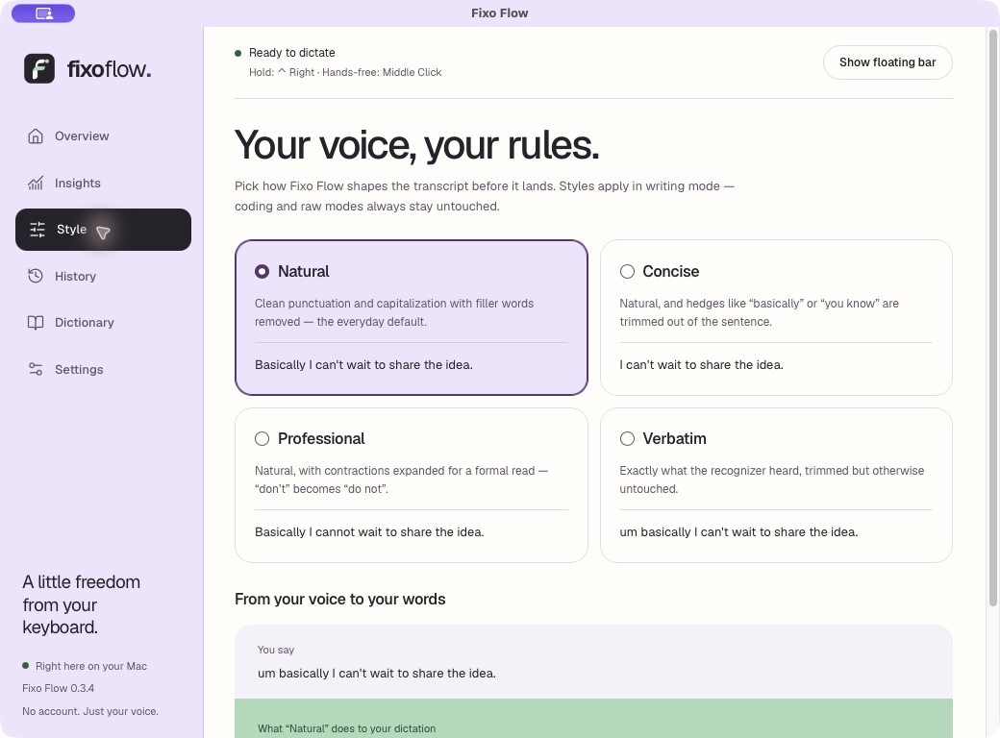
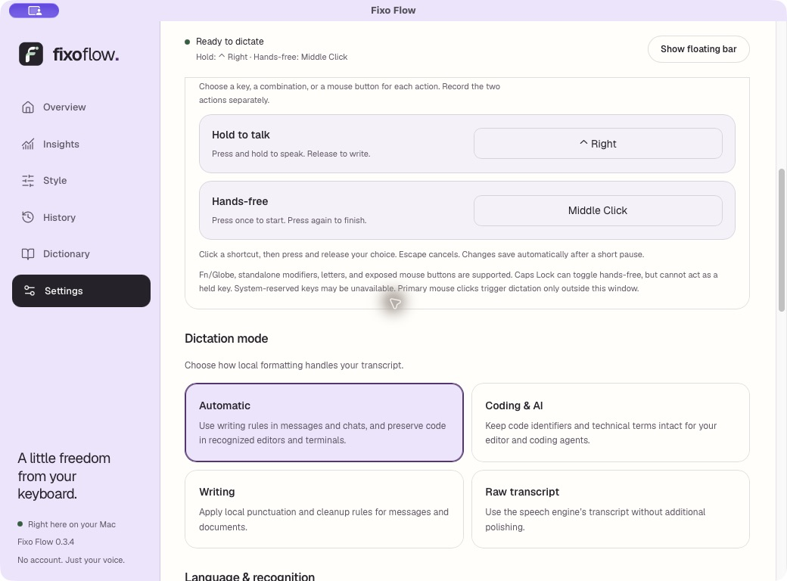

<div align="center">
  

# Fixo Flow

### A little freedom from your keyboard.

Free, open-source voice dictation. Speak into your everyday apps, with recognition on your computer.

[](LICENSE)
[](https://github.com/abrar225/FixoFlow/releases)
[](https://github.com/abrar225/FixoFlow/actions/workflows/portable-core.yml)

**[Website](https://fixoflow.tech) · [Download](https://github.com/abrar225/FixoFlow/releases) · [Report a problem](https://github.com/abrar225/FixoFlow/issues) · [Contribute](CONTRIBUTING.md)**

macOS Apple Silicon · Windows x64 preview · Ubuntu X11 preview

</div>

> **Experimental preview — 0.3.4.** English dictation is available. Multilingual
> dictation, including Hindi and Roman Hinglish, is **coming soon**, not delivered
> in this release. Accuracy and performance vary by microphone, speech and hardware.
> The project welcomes contributions; it does not promise identical behavior on every OS.

## See the product


*Actual macOS application: choose a writing style while keeping recognition local.*


*Actual macOS application: separate shortcuts, automatic saving and dictation modes.
These screenshots show the interface, not a benchmark or proof of recognition accuracy.*

## What you can do

- **Hold to talk or go hands-free.** Record two independent keyboard/mouse shortcuts in Settings.
- **Write where you already work.** Your transcript goes to the clipboard first, then Fixo Flow attempts to paste into the original app.
- **Keep your own vocabulary.** Add names and exact corrections to a local dictionary.
- **Choose your style.** Natural, Concise, Professional or strict Verbatim; polishing uses offline rules.
- **Recover your words.** Review local history when insertion fails. Explicit history deletion removes linked owned audio too.
- **Make it fit your day.** Start quietly at login, use the floating controls, and let preferences save after a short pause.

No account, subscription or cloud transcription. Optional startup/manual update
checks request public release metadata; disable startup checks for offline-only
use. Audio and transcripts are not sent with update requests.

## Download and get started

Get packages from **[GitHub Releases](https://github.com/abrar225/FixoFlow/releases)**.
The **[website download guide](https://fixoflow.tech/download/)** shows the same
release links, requirements and platform-specific setup steps.

- **macOS:** Apple Silicon, macOS 14+. The DMG contains a self-contained app and the English model. Drag into Applications, then review Microphone, Accessibility and Input Monitoring permissions. Restart after granting Input Monitoring.
- **Windows:** x64; Windows 11 is the target, Windows 10 22H2 a compatibility target. WebView2 and the Microsoft Visual C++ runtime are required. Physical-device acceptance is still pending.
- **Linux:** Ubuntu 24.04 x64 with an X11 desktop. Install the `.deb` with a package manager so declared system dependencies are resolved. Wayland global shortcuts and automatic paste are not supported yet.

**OS trust matters.** Mac previews are locally signed, not Apple-notarized;
Windows previews are unsigned. Gatekeeper, SmartScreen or Smart App Control may
warn or block them. Open-source availability does not remove those warnings.
Keep OS protections enabled. If a package is rejected or offered to move to Trash,
report the exact dialog, OS version and release filename; do not treat that as
proof of an incomplete download or disable protection as a workaround.

Verify downloads against the release's `SHA256SUMS.txt` when investigating file
integrity. A matching checksum establishes matching bytes, not publisher trust.

## Your first dictation

1. Open Fixo Flow and review microphone/input permissions for your OS.
2. In Settings, record separate **hold-to-talk** and **hands-free** shortcuts.
3. Click the text field you want to write in.
4. Hold your shortcut and speak; release to transcribe. Or tap hands-free once to start and again to finish.
5. Review the result. If automatic paste fails, use the clipboard or local History.

Clear spoken sequences such as “Firstly… Second… Third…” become numbered lists
in Writing mode and Automatic messaging mode. Spoken punctuation commands are
opt-in. Verbatim keeps recognizer wording. US, UK and India English share one
English recognizer; spelling is not forced by a regional prompt.

## How it works


The Mac engine uses MLX; Windows and Linux use CTranslate2/faster-whisper on CPU.
Packages include their English model. Runtime inference does not download a
missing model silently. Multilingual packs remain research-only in this release.

## Privacy and updates

Preferences, SQLite history and recordings live under `~/.fixoflow/` (`~` is your
user home on Windows too). Mac logs are under `~/Library/Logs/Fixoflow/`.
Cancelled/incomplete recordings may remain for recovery; automatic retention and
a recovery inbox are not implemented. Do not share these files without reviewing
them for personal content.

Update checks use `https://fixoflow.tech/releases/latest.json` and direct you to
public GitHub downloads through the website. Updates are **manual**; signed
background installation is not enabled. The feed remains compatible with 0.3.3.
Older clients can always install the current package manually from Releases.

## Develop locally

Use Python 3.12 and a platform-appropriate virtual environment:

```sh
python3.12 -m venv .venv
# Activate .venv for your shell, then:
python -m pip install -e '.[dev]'
# Windows: python -m pip install -e '.[windows,dev]'
# Linux:   python -m pip install -e '.[linux,dev]'
python -m pytest tests/ -q
```

Linux also needs GTK/WebKit, PortAudio, X11 clipboard/input components and the
PyGObject bindings. See [packaging](docs/packaging.md) and the native build
[workflow](.github/workflows/desktop-preview.yml) for the exact build environment.
Source runs need a compatible local model; native installers already bundle one.
Tests use isolated data and simulated boundaries unless explicitly described as
native inference/UI checks; passing them is not a speech-accuracy claim.

For the static website:

```sh
cd Landing_Page
npm ci
npm run lint
npm run build
npm run audit:copy
```

## Help improve it

Read **[CONTRIBUTING.md](CONTRIBUTING.md)**. Useful contributions include:

- Reproducing and fixing microphone, shortcut and paste failures on real devices.
- Public publisher signing/notarization and reproducible packaging.
- Noise and speech-quality evaluation using consented recordings.
- Accessibility, low-end hardware measurements and platform documentation.
- Multilingual and Hinglish research with explicit accuracy evidence.

Please report observed behavior rather than claiming universal compatibility or
99% accuracy. English recognition also makes mistakes; review important text.

<details>
<summary><strong>Engineering notes and research</strong></summary>

- [Build and packaging](docs/packaging.md)
- [Platform/release plan](docs/07-platform-and-release-plan.md)
- [English quality and multilingual research](docs/13-english-quality-and-multilingual-research.md)
- [Startup and autosave](docs/12-startup-autosave-and-hinglish.md)
- [Current open-source distribution](docs/17-open-source-release.md)
- [Original assessment and measured limitations](docs/2026-10-17-assessment.md)

</details>

## License

**[MIT](LICENSE)** — use, study, modify and contribute. Third-party libraries and
speech models retain their respective licenses and required notices.
