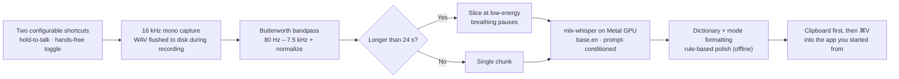
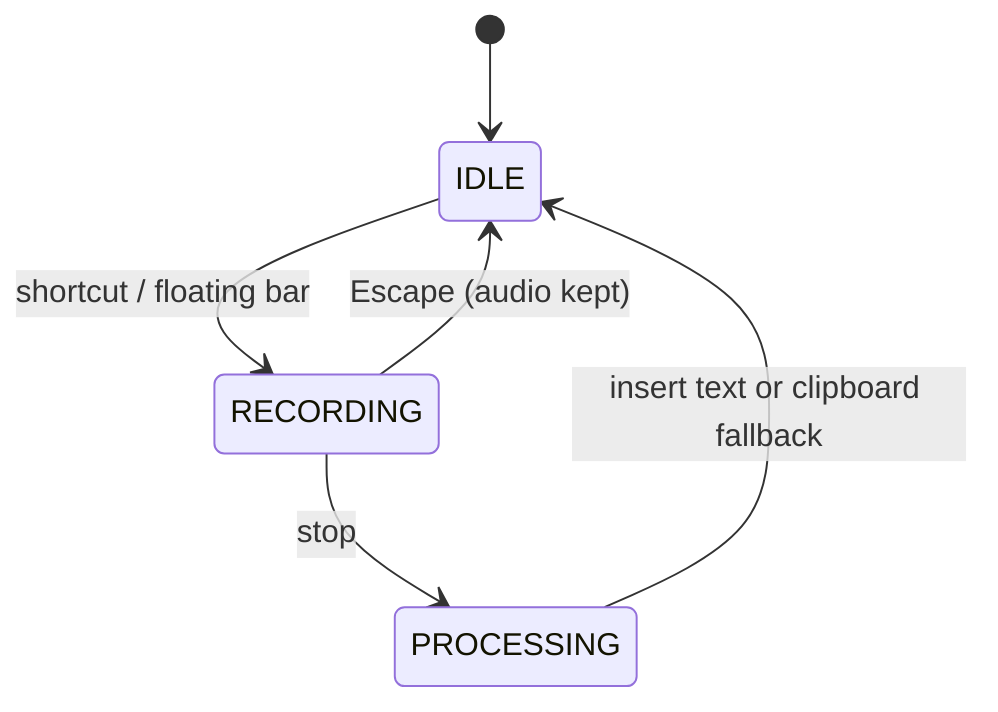

<div align="center">

# Fixoflow

**Private, local-only voice dictation for Apple Silicon Macs.**

Speak anywhere you type, in any app. Your audio and transcript never leave the Mac.


</div>

> **Status: experimental.** Fixoflow is a working local dictation prototype, not yet a verified daily-use replacement for Wispr Flow. Accuracy, latency, and memory claims are unproven; the Python/MLX inference stack currently exceeds its original 200 MB memory target. See the [assessment](docs/2026-10-17-assessment.md).

---

## Product release and platform status

The initial release identity is **0.1.0**. The Mac app has separate configurable
hold-to-talk and hands-free shortcuts, recent history on Overview, and release
checking in Settings. The selected Windows target is **Windows 11 x64**; the
local speech backend and shared-code preparation are present, but the Windows
desktop host, native integrations, installer, and hardware acceptance remain.
See the [task ownership, Windows plan, and signed-update runbook](docs/07-platform-and-release-plan.md).

## How it works



Every transcript is stored in local SQLite history, so text is recoverable even when insertion fails.

## Dictation behavior

| Gesture | Result |
| :-- | :-- |
| Hold-to-talk shortcut | Press to record; release to stop and transcribe |
| Hands-free shortcut | Press once to start; press again to stop and transcribe |
| Escape | Cancels capture; the audio file is kept |
| Click the floating pill | Same toggle control, no keyboard needed |
| Drag the floating pill | Press anywhere on it (buttons included) and drag; it drops into the nearest of four slots — top center, bottom left, bottom center, bottom right — and remembers it |

The floating pill is a 116 × 30 pt glass capsule over a real macOS backdrop blur (`NSVisualEffectView`), so it stays out of the way; it expands only while you hover, record, or when a result needs to be shown. Idle it sits at 82% opacity, wakes to full opacity on hover, and its width, corner radius, and position all animate between states. While dragging, ghost outlines show the four snap slots and the nearest one highlights; a click that follows a drag is suppressed, so dragging can start from a button without ever firing it.

Text delivery is **clipboard-first**: the transcript is copied before any keystroke is posted. If the target app moved to the background, Fixoflow tries to refocus it; if Accessibility is missing or the paste keystroke is rejected, the text is already on your clipboard and a notification explains what happened.



## Local data

| Path | Contents |
| :-- | :-- |
| `~/.fixoflow/config.json` | Preferences (atomic saves, `.json.bak` backup on change) |
| `~/.fixoflow/fixoflow.sqlite` | Completed sessions, dictionary, daily analytics |
| `~/.fixoflow/audio_cache/` | Session WAVs + `.transcript.json` partial recovery files |
| `~/Library/Logs/Fixoflow/fixoflow.log` | Rotating log |

No accounts or telemetry. Dictation stays on-device. Optional startup/manual update checks request only public GitHub release metadata; signed update downloads require a separately configured Sparkle appcast. Disable startup checks in Settings for an offline-only workflow. Runtime transcription uses a bundled model, an explicit local model directory, or an already-cached snapshot; a missing model produces an error instead of a download. Cloud polishing is removed — older Gemini keys load as offline rules and are never read, and unknown/legacy config keys are ignored instead of crashing.

Shortcuts are recorded in Settings, including exposed keyboard keys, modifiers,
Fn/Globe, and mouse buttons. Legacy preferences migrate without being overwritten
until Save. See the release plan for primary-mouse and reserved-key behavior.

## Modes

| Mode | Behavior |
| :-- | :-- |
| Automatic | Picks coding vs. writing from the frontmost app name |
| Coding & AI | Dictionary + spoken-code commands (`camel case get user id` → `getUserId`, `dash dash verbose` → `--verbose`) |
| Writing | Local rule-based cleanup, preserve line breaks |
| Raw | Speech engine output untouched |

The personal dictionary conditions the recognizer prompt and rewrites final text. Replacements are treated as literal text — backslashes and `\1` never corrupt output. Only entries you add are authoritative; model output is never auto-promoted.

## Insights & style

| Hub tab | What it shows |
| :-- | :-- |
| Insights | Daily streak with best-streak record and a week strip, words dictated today, lifetime words, dictations, average speaking pace, time saved, apps used, dictionary size — and the two learning counters: polish fixes (filler/spacing/punctuation cleanup) and fixes made by Fixoflow (learned terms and spoken-code replacements). Every number is aggregated from local SQLite; nothing leaves the Mac. |
| Style | Four writing-mode styles — Natural, Concise, Professional, Verbatim — each with a preview of what it does. Stored as `output_style` and applied by the offline polisher; coding and raw modes are never touched. |

Fixoflow appears in the Dock and app switcher like a regular app. The floating pill stays a nonactivating panel, so clicking it never steals focus, and quitting from the Dock stops dictation cleanly.

## Permissions

| Permission | Why | Where |
| :-- | :-- | :-- |
| Microphone | Capture speech | System Settings → Privacy & Security → Microphone |
| Accessibility | Paste ⌘V at the cursor | … → Accessibility |
| Input Monitoring | Global shortcut while other apps are focused | … → Input Monitoring |

The Settings tab shows live status for all three and a **Request permissions** button that raises the system prompts. macOS applies new grants only to a freshly started app, so after allowing Input Monitoring click **Restart Fixoflow** in Settings (or the menu-bar item) — the shortcut then activates by itself within a second; **Retry shortcut** forces an immediate re-check. Without Accessibility, dictation still works — text lands on the clipboard with a notification instead of pasting, and the app never re-raises the system dialog on its own.

You only need to grant permissions once: builds are signed with a stable local signing identity (see below), so grants survive updates instead of resetting on every rebuild.

## Install

Build a self-contained `Fixoflow.app` (bundles Python, MLX, PortAudio and the `mlx-community/whisper-base.en-mlx` model):

```sh
uv pip install --python .venv/bin/python -e '.[packaging]'
bash scripts/create_signing_cert.sh   # one time: stable local signing identity
bash scripts/build_app.sh
bash scripts/build_dmg.sh
```

Then copy `dist/Fixoflow.app` to `/Applications` and launch it. `create_signing_cert.sh` creates a self-signed "Fixoflow Local Signing" certificate in your login keychain; signing with it anchors macOS permission grants to the certificate instead of the binary hash, so Accessibility / Input Monitoring / Microphone grants survive rebuilds. Without it, builds fall back to ad-hoc signing and every update resets permissions. Builds are not Developer ID signed or notarized. See [packaging notes](docs/packaging.md).

## CLI

```sh
fixoflow start                 # floating bar, no hub window
fixoflow hub                   # open the hub dashboard
fixoflow record [--no-paste]   # interactive terminal dictation
fixoflow transcribe file.wav   # resample/filter/format an existing file
fixoflow config --hotkey '<cmd>+<shift>+d' --model ...
```

## Development

```sh
uv sync --extra dev
.venv/bin/pytest tests/ -q
.venv/bin/python -m fixoflow.app --self-check   # UI + model check, no mic
```

Tests use isolated databases and simulated capture/decode boundaries — they do not record the microphone or prove recognition accuracy. The packaged app supports `--packaging-check [--inference]` for bundle and real-Metal checks.

## Limitations

- Insertion posts a ⌘V keystroke; that does not prove the receiving app kept the same text field. History is the recovery path.
- Absolute zero loss cannot be guaranteed against disk, power, or process failures. Partial text from failed chunks is saved as `.transcript.json` next to the audio and never pasted as if complete.
- App detection uses name heuristics; websites and terminal agents are not distinguished.
- Peak memory of the Python/MLX stack exceeds the original 200 MB target on this machine.

## Documentation

| Doc | Purpose |
| :-- | :-- |
| [App brief](docs/00-app-brief.md) | Product summary |
| [PRD](docs/01-prd.md) | Requirements |
| [TRD](docs/02-trd.md) | Architecture & stack |
| [App flow](docs/03-app-flow.md) | States and journeys |
| [UI/UX brief](docs/04-ui-ux-brief.md) | Interface direction |
| [Backend schema](docs/05-backend-schema.md) | Local data model |
| [Implementation status](docs/06-implementation-plan.md) | Code map & tests |
| [Packaging](docs/packaging.md) | Build & verify |
| [Assessment 2026-10-17](docs/2026-10-17-assessment.md) | Honest measurements & limits |

## License

MIT — see [LICENSE](LICENSE).
