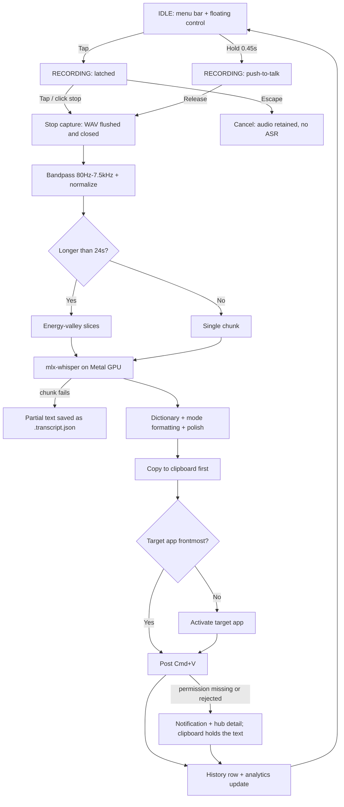

# App Flow: Fixoflow

## 1. Entry Points
- **Installed app:** `Fixoflow.app` (regular Dock app — a menu-bar item, a Dock icon, and the hub open on first launch).
- **CLI:** `fixoflow start` (floating control only), `fixoflow hub`, `fixoflow record`, `fixoflow transcribe file.wav`.
- **Reopen:** launching again signals the running instance via `com.fixoflow.showHub` instead of starting a second copy; clicking the Dock icon opens the same hub.

---

## 2. Authentication Flow
- **Local application:** no accounts, passwords, or cloud logins.
- **macOS permission gates (one-time, user-granted):**
  1. *Microphone* — required for capture. Status shown in the hub; request button available.
  2. *Accessibility* — required for synthetic ⌘V insertion. Without it, transcripts still copy to the clipboard and a notification explains the fix; the system prompt is raised only on explicit request, never from a failed paste.
  3. *Input Monitoring* — required for the global shortcut listener. macOS applies grants only to a newly started process, so the hub offers **Restart Fixoflow**; on relaunch the listener activates by itself once both grants are live (the hub also re-checks each second).
- **Stable grant identity:** the bundle is signed with the local "Fixoflow Local Signing" certificate, so the designated requirement is certificate-anchored and grants survive rebuilds (ad-hoc signing would pin them to the binary hash).

---

## 3. Screen & State Inventory

| State | Mode | Purpose | Entry | Primary action | Failure | Success |
| :-- | :-- | :-- | :-- | :-- | :-- | :-- |
| **IDLE** | Background | Menu bar + compact glass pill wait (116 × 30 pt; hover expands; press anywhere to drag it among four snap zones) | Launched, permissions checked | Shortcut or click | Shortcut listener blocked → explicit detail in hub/menu | → RECORDING |
| **RECORDING** | Capture | 16 kHz blocks persisted to WAV | Shortcut tap/hold, floating control | Speak; Escape cancels | Mic unplugged → `RecordingError`, state rolls back | → PROCESSING |
| **PROCESSING** | Inference | Filter, slice, transcribe, format | Stop gesture | Wait (new starts disabled) | Chunk failure → partial `.transcript.json`, never a fake success | → insertion |
| **DELIVERY** | Insertion | Clipboard write, focus restore, ⌘V | Transcript ready | Automatic | `permission` / `event-failed` / `clipboard-failed` → notification + hub detail | → IDLE |

---

## 4. Mermaid Flowchart

---

## 5. Primary User Journey (Happy Path)

1. **User focus:** cursor is in an editor, terminal, mail, or chat.
2. **Activation:** user taps the shortcut (or holds it). `Tink` plays; the floating control shows "Listening" with elapsed time.
3. **Speech:** user speaks for 45 seconds, including natural pauses.
4. **Deactivation:** tap again or release the held key. `Basso` plays.
5. **Processing:** the WAV is already on disk; filtering and slicing run; each slice is transcribed locally; dictionary and mode rules format the transcript.
6. **Delivery:** the transcript is copied to the clipboard, focus returns to the original app if needed, and ⌘V is posted. History records app, duration, word count, and processing time.
7. **Failure path:** if paste cannot be posted, the notification says exactly why, the text is on the clipboard, and the session is in History.

---

## 6. Secondary Journeys

### Terminal dictation
- `fixoflow record` prompts for Enter to start and stop, prints the result, and reports the delivery outcome (pasted, clipboard untouched with `--no-paste`, or the failure reason).

### File transcription
- `fixoflow transcribe audio.wav` resamples to 16 kHz when needed, applies the configured mode formatting and polish, and prints raw and polished text.

### Permission setup
- Settings shows Accessibility / Input Monitoring / Microphone status. **Request permissions** raises all system prompts; per-permission buttons deep-link into System Settings.
- **Restart Fixoflow** (Settings or menu bar) spawns a fresh instance after a short delay, then exits the old process — the only way a grant can reach a running app under macOS TCC. The hub also probes permissions once per second while the shortcut is inactive, so the listener starts by itself as soon as the grants are live. **Retry shortcut** forces the same check immediately.

### Configuration changes
- Saving settings validates the hotkey (recorded via the shortcut button or presets; at least one modifier or a function key), persists atomically with a backup, rebuilds the recorder/STT/polisher on the live app, and restarts the shortcut listener when permitted.
- Dragging the pill is a lightweight save: only `overlay_position` changes and the hub refreshes; no engines are rebuilt. Picking a style card saves only `output_style` the same way — no engine rebuild.

### Insights and style
- The Insights tab reads only local aggregates (streak, today, week, lifetime counts, fix counters) built from `history`; it never runs inference and never leaves the device.
- The Style tab sets the writing-mode polish level; the next dictation in writing mode uses it. Coding and raw modes ignore styles by design.

---

## 7. Decision Points

| User action | Condition | Result | Destination |
| :-- | :-- | :-- | :-- |
| Drag the pill | Any state | Snap guide shows the four slots; release drops into the nearest zone and saves the choice; a press that moved never counts as a click | same state |
| Save a style card | Hub open | `output_style` persists; writing-mode polish changes on the next dictation | same state |
| Press shortcut | IDLE | Recording starts; `Tink` | RECORDING |
| Release before threshold | Recording (hold gesture) | Latch stays recording | RECORDING |
| Release after threshold | Recording (hold gesture) | Stop and process | PROCESSING |
| Press shortcut / click stop | Recording (latched) | Stop and process | PROCESSING |
| Escape | Recording | Cancel; audio file retained | IDLE |
| Start while PROCESSING | — | Ignored; control disabled | PROCESSING |

---

## 8. Edge Cases and Recovery

1. **Empty audio / no speech:** pipeline aborts with a clear overlay message; nothing is pasted, History stays clean.
2. **Microphone failure or disconnect:** `RecordingError` surfaces; state returns to IDLE; already-flushed audio remains on disk.
3. **Accessibility missing:** clipboard-first insertion reports `permission` and notifies; the text stays on the clipboard until the user pastes manually. The system prompt is never raised from an insertion attempt — the hub's **Request permissions** button is the one place prompts appear.
4. **Paste keystroke rejected:** `event-failed`; clipboard keeps the text; notification says to paste manually.
5. **No silence for slicing:** hard cut at 24 s with a cross-fade; sample count is preserved.
6. **Chunk decode failure:** partial text saved beside the audio as `.transcript.json`; the session is marked incomplete and never pasted as complete.
7. **Focus changed mid-dictation:** Fixoflow tries to reactivate the original app; if that fails, the transcript stays on the clipboard instead of being typed into the wrong window.
