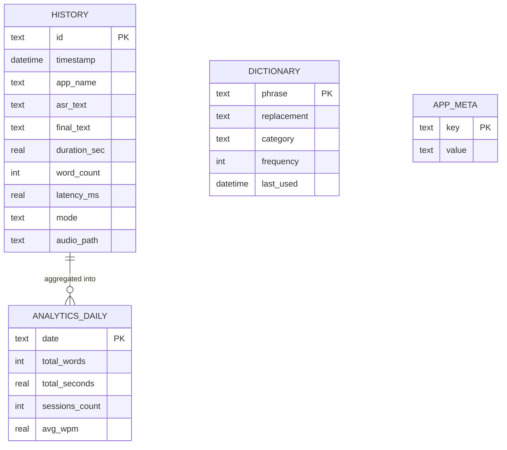

# Backend & Local State Schema: Fixoflow

## 1. Data Overview
- **Storage type:** 100% local — JSON configuration, SQLite database, WAV audio cache, rotating logs.
- **Primary data location:** `~/.fixoflow/` (logs in `~/Library/Logs/Fixoflow/`).
- **Ownership model:** single-user POSIX permissions owned by the current macOS user.
- **Cloud database:** none. No accounts, no syncing, no telemetry.

---

## 2. Local State & File Hierarchy

```
~/.fixoflow/
├── config.json                  # Preferences (atomic writes; config.json.bak keeps the previous file)
├── fixoflow.sqlite              # History, dictionary, daily analytics, app metadata
├── app.lock                     # Single-instance lock (flock)
└── audio_cache/
    ├── session_20261017_114201_123456.wav   # 16-bit PCM mono WAV, written during capture
    └── session_20261017_114201_123456.transcript.json   # only after a chunk failure

~/Library/Logs/Fixoflow/
└── fixoflow.log                 # Rotating log (1 MB × 3)
```

---

## 3. Configuration Schema (`~/.fixoflow/config.json`)

| Field | Type | Default | Description |
| :--- | :--- | :--- | :--- |
| `model_name` | string | `"mlx-community/whisper-base.en-mlx"` | Local/bundled/cached MLX model identifier. |
| `language` | string \| null | `"en"` | Whisper language; `null` enables auto-detect. |
| `initial_prompt` | string | `"Clean, punctuated English speech."` | Base decoder conditioning (vocabulary terms are appended per session). |
| `mode` | string | `"auto"` | `auto` \| `coding` \| `writing` \| `raw`. |
| `sample_rate` | int | `16000` | Fixed; validation rejects other values. |
| `channels` | int | `1` | Fixed mono. |
| `max_continuous_segment_sec` | float | `24.0` | Hard slice ceiling (1–24 s). |
| `cache_dir` | string | `~/.fixoflow/audio_cache` | Session audio directory. |
| `polishing_engine` | string | `"rules"` | `rules` (offline) or `none`. |
| `hotkey` | string | `"<ctrl>+<space>"` | pynput shortcut syntax. |
| `dual_mode_hotkey` | bool | `true` | Enable tap-and-hold gestures. |
| `hold_threshold_sec` | float | `0.45` | Tap vs. hold boundary (0.1–2.0 s). |
| `hold_to_talk` | bool | `false` | Force hold-only behavior. |
| `always_show_overlay` | bool | `true` | Keep the floating control visible. |
| `sound_enabled` | bool | `true` | Play state sounds. |
| `log_level` | string | `"INFO"` | Logging level. |

Loading behavior:
- Unknown keys (for example `gemini_api_key`, `groq_api_key`) are ignored with a warning — they never break startup.
- Legacy `dual_mode_threshold_sec` maps onto `hold_threshold_sec`; legacy `polishing_engine: "gemini"` loads as `"rules"`.
- Malformed JSON raises and leaves the file untouched; saves are atomic (temp file + `os.replace`) and back up the previous file.

---

## 4. SQLite Schema (`~/.fixoflow/fixoflow.sqlite`)

### `history` — completed sessions

| Column | Type | Notes |
| :--- | :--- | :--- |
| `id` | TEXT PK | UUID. |
| `timestamp` | DATETIME | ISO-8601 local time. |
| `app_name` | TEXT | Frontmost app at session start. |
| `asr_text` | TEXT | Raw recognizer output. |
| `final_text` | TEXT | After dictionary/mode formatting and polish. |
| `duration_sec` | REAL | Audio length. |
| `word_count` | INTEGER | Words in `final_text`. |
| `latency_ms` | REAL | Stop-to-text processing time. |
| `mode` | TEXT | Mode active for the session. |
| `audio_path` | TEXT | Recovery WAV path. |

### `dictionary` — personal vocabulary

| Column | Type | Notes |
| :--- | :--- | :--- |
| `phrase` | TEXT PK | Spoken phrase, matched case-insensitively with word boundaries. |
| `replacement` | TEXT | Inserted literally (never interpreted as a regex template). |
| `category` | TEXT | `ai` \| `code` \| `acronym` \| `general`. |
| `frequency` | INTEGER | Incremented when the phrase matches a transcript. |
| `auto_learned` | INTEGER | Reserved; built-in seeds and user entries are inserted with 0. |
| `last_used` | DATETIME | Updated on match. |

Seeding writes built-in terms once (tracked by the `vocabulary_seeded` key); `INSERT OR DO NOTHING` semantics mean a deleted seed stays deleted.

### `analytics_daily` — derived aggregates

| Column | Type | Notes |
| :--- | :--- | :--- |
| `date` | TEXT PK | `YYYY-MM-DD`. |
| `total_words` | INTEGER | Sum over sessions of that day. |
| `total_seconds` | REAL | Sum of durations. |
| `sessions_count` | INTEGER | Row count. |
| `avg_wpm` | REAL | `words / (seconds / 60)`. |

Analytics are a cache over `history`: recomputed on startup and after `delete_history_item` / `clear_all_history`, so the dashboard can never drift from the sessions it summarizes.

### `app_meta` — key/value metadata

| Column | Type | Notes |
| :--- | :--- | :--- |
| `key` | TEXT PK | e.g. `vocabulary_seeded`. |
| `value` | TEXT | e.g. `"1"`. |

---

## 5. Relationship Map



`ANALYTICS_DAILY` has no independent lifecycle: it is rebuilt from `HISTORY` whenever history changes. `DICTIONARY` and `APP_META` are independent user/application state.

---

## 6. Audio Cache & Recovery Rules
- **Format:** 16-bit PCM linear mono WAV at 16 kHz; headers updated during capture and flushed/fsynced with each queued block.
- **Partial sessions:** a chunk failure writes `<session>.transcript.json` (`status`, `text`, `raw_text`) next to the WAV. Partial text is never pasted as a complete result.
- **Deletion:** history rows can be deleted individually or cleared from the hub; audio files are retained on disk for manual recovery and are not automatically pruned by the current build.
- **Disk footprint:** one minute of audio is ~1.92 MB; 100 typical 15 s dictations are <50 MB.
