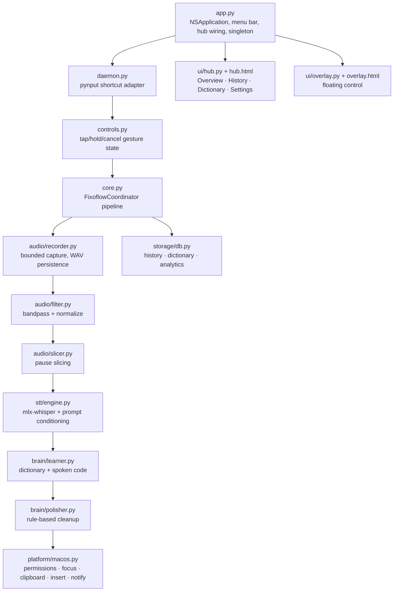

# Implementation Status: Fixoflow

This document maps the shipped implementation to concrete files and tests. It replaces the earlier planning draft, which referenced placeholder paths (`fixoflow/history.py`, `tests/test_filter.py`, `tests/test_stt_accuracy.py`) and cloud/NaturalLanguage components that are not part of the product.

## 1. Principles
- 100% offline, local, low-overhead; legacy cloud settings are inert.
- Never report success for audio that was not persisted or a transcript that was not delivered.
- Every change keeps `pytest` green; boundary behavior is tested where hardware is not required.

## 2. Module Map



## 3. Feature Status

| Area | Status | Files | Tests |
| :--- | :--- | :--- | :--- |
| Bounded capture with incremental WAV persistence | Done | `audio/recorder.py` | `test_recorder.py` |
| Butterworth bandpass + normalization | Done | `audio/filter.py` | `test_audio_filter.py` |
| Energy-valley slicing (>24 s) | Done | `audio/slicer.py` | `test_audio_slicer.py` |
| MLX Whisper with vocabulary prompt | Done | `stt/engine.py`, `brain/learner.py` | `test_stt.py`, `test_learner_and_db.py` |
| Offline polish with raw fallback | Done | `brain/polisher.py` | `test_polisher.py` |
| Tap/hold/cancel gestures | Done | `controls.py`, `daemon.py` | `test_controls.py` |
| Clipboard-first insertion + focus restore + notifications | Done | `platform/macos.py`, `core.py` | `test_macos.py`, `test_coordinator.py` |
| Local SQLite history + derived analytics | Done | `storage/db.py` | `test_learner_and_db.py` |
| Legacy config tolerance + atomic saves | Done | `config.py` | `test_config.py` |
| Hub bridge (permissions, config, history, dictionary) | Done | `ui/hub.py`, `ui/hub.html` | `test_hub_controls.py` |
| Floating control + menu bar | Done | `ui/overlay.py`, `ui/overlay.html`, `app.py` | `--self-check` |
| Self-contained packaging (model bundled, LSUIElement) | Done | `packaging/Fixoflow.spec`, `scripts/build_*.sh` | `--packaging-check` |
| Developer ID signing / notarization | Not started | — | — |
| Inference memory below 200 MB | Not met | `stt/engine.py` | see [assessment](2026-10-17-assessment.md) |
| Correction feedback with provenance / per-app profiles | Proposed | — | — |

## 4. Verification Commands

```sh
.venv/bin/pytest tests/ -q                      # full suite
.venv/bin/python -m fixoflow.app --self-check   # Cocoa/WebKit + model resolution
bash scripts/build_app.sh && bash scripts/build_dmg.sh
dist/Fixoflow.app/Contents/MacOS/Fixoflow --packaging-check
dist/Fixoflow.app/Contents/MacOS/Fixoflow --packaging-check --inference
```

## 5. Known Gaps
- Real microphone capture, live shortcut gestures, and insertion into user apps are verified manually; automated tests simulate those boundaries.
- App-context detection is heuristic (app name), not window/website aware.
- Audio cache pruning is manual in the current build.
